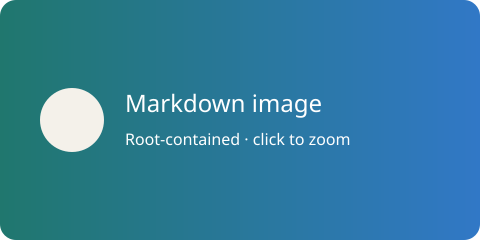

# Markdown 图片阅读

桌面端与 mobile 的 Markdown 渲染模式支持行内、引用式图片：PNG、JPEG、WebP、GIF和安全静态SVG。源码模式不变。以下示例同时用于本地交付检查：

![Reference SVG][example]

[example]: assets/markdown-image-example.svg

## 根目录与外链

相对路径以 Markdown 所在目录计算，允许根内 `../`、中文和空格；实际文件访问仍受固定根目录与防符号链接替换约束。mobile根始终来自服务端Session cwd。桌面文档绑定打开时的设备/浏览根，不因之后切换设备或文件树而换目标；无关联根的独立文件以父目录为界。

外链默认不请求；点击「加载当前文档外链图片」后，本次阅读的可见图片由**阅读设备**原生匿名获取，而不是文档主机代理。只接受公开HTTPS，禁止凭据、Cookie、Referer、私有/保留地址及不安全重定向；解析出的所有IP都须公开，固定解析结果连接，并禁用隐式代理。若系统DNS使用198.18等fake-IP映射，这类结果会被拒绝，不为兼容代理而绕过安全检查。

以下公开HTTPS图片用于可选联网检查，打开文档本身不会访问它：

## 交互与限制

- 正文按比例适应宽度，点击大图后可缩放、拖动、适应窗口；关闭保持阅读位置。手机双指缩放和拖动不触发切页，桌面支持滚轮/指针操作和Escape关闭。被外层超链接包裹的图片点击优先大图。
- 单张最大20MiB、2000万像素；先验证实际格式/头尺寸，损坏的压缩内容在有界浏览器解码失败时显示错误及重试，不伪称已完整解码验证。
- SVG经过XML/元素/深度/静态样式/本地引用展开限制和清洗后，才作为Blob图片解码；不插入任意HTML，不执行脚本/动画，不加载子图片、外部字体/样式或链接。安全静态SVG是有界子集，不支持所有CSS。
- 读期缓存限制64MiB、按需加载并允许淘汰非可见资源；同一文档树/预览/终端往返复用已加载资源。更换文档/内容/设备或关闭阅读时释放Blob和外链授权，不保证跨App重启离线可用。无实时图片文件监听。
- 加载中、路径阻止、超限、格式/网络失败均有说明，可重试；不新增保存/分享、独立图片预览、HTML img、内网/登录图片或持久授权。Mermaid资产策略不变。

## 原生与服务接口

阅读设备提供 `markdown_image_fetch {url}`、`markdown_image_validate {contentBase64}`，返回 `{mime,width,height,contentBase64}`。移动端使用内置公开CA根避免依赖iOS/Android不存在的Unix PEM路径；桌面使用系统可信根，均保持TLS校验。

桌面根内图片使用 `document.images.open/chunk/finish/close`，open即限制20MiB，后续256KiB分块、身份/修改时间及长度/摘要检查，结束close；handle不与Session下载混用。mobile独立只读流程使用既有`session.files.download.*`，根仍由Session记录确定；不会创建/占用界面中的全局下载任务。

平台和实时联网交付证据见 `docs/tasks/2026-10-13-markdown-image-rendering-task.md`。测试fixture不会冒充原生DNS/TLS/真机行为。
